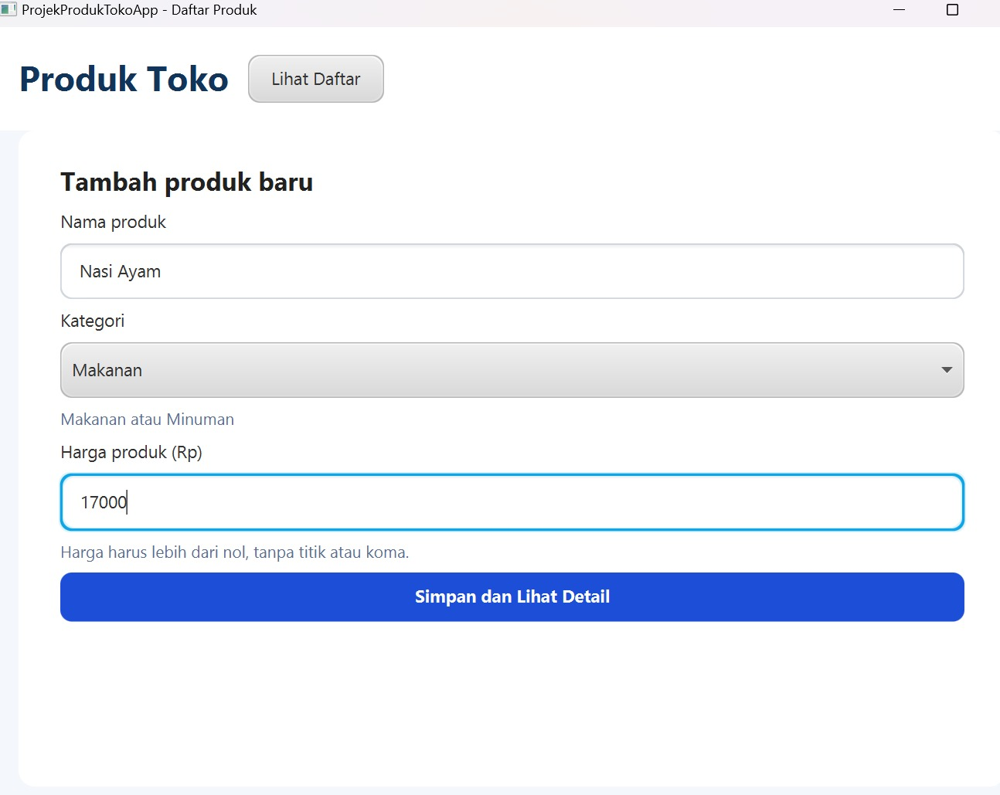
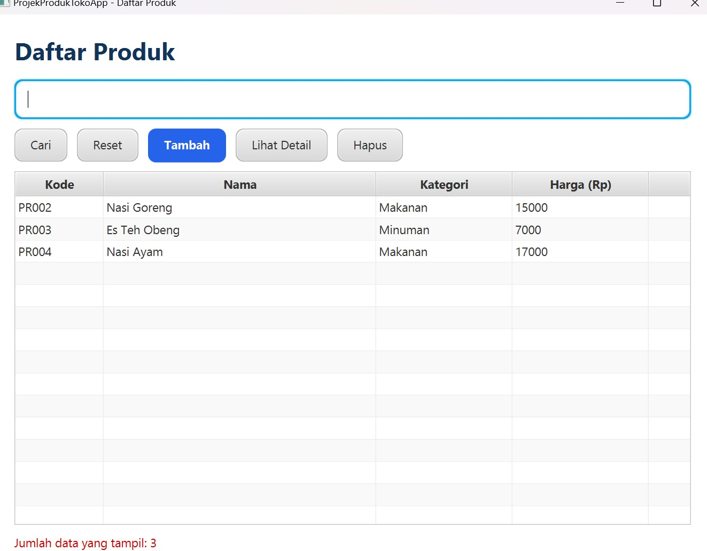
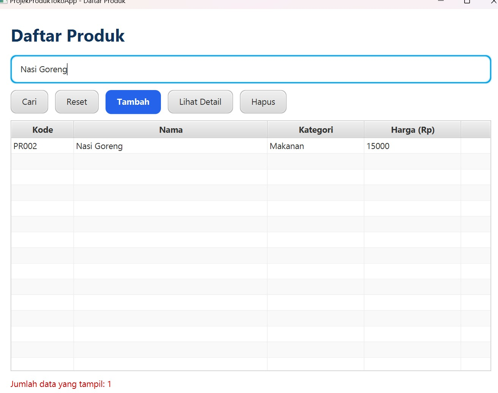
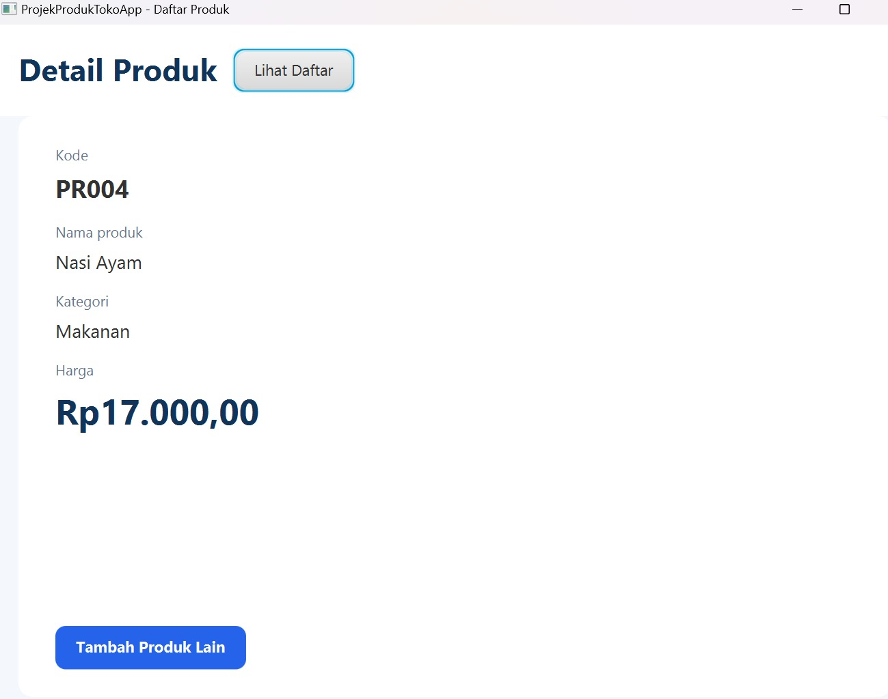
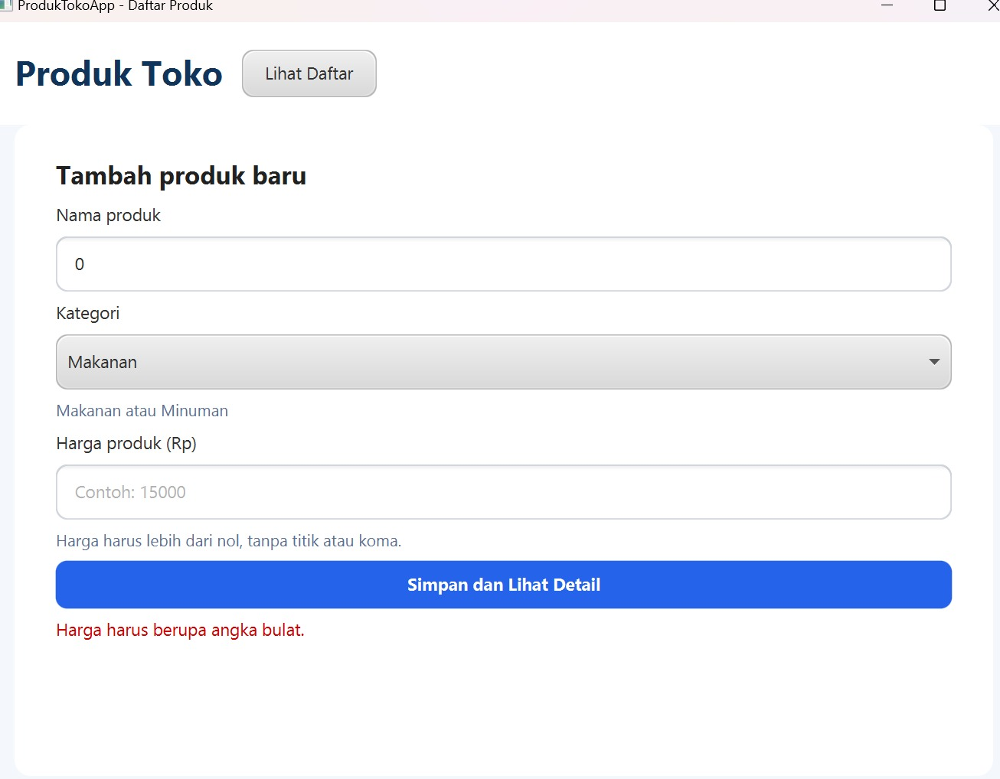

Aplikasi desktop **JavaFX** untuk mencatat produk toko. Proyek ini adalah hasil modifikasi aplikasi praktikum **TiketApp** (Praktikum GUI Lanjutan) menjadi aplikasi daftar produk, dengan struktur dan pola kode yang sama (MVC sederhana: model, data, controller, FXML, CSS).

- **Nama:** Pilipe Kenantofi Sitorus
- **NIM:** 2503988
- **Mata kuliah / Tugas:** Pengantar JavaFX GUI - Level 2 (Tugas Individu)

## Fitur

1. **Form tambah produk**: nama, kategori (Makanan/Minuman), dan harga. Kode produk dibuat otomatis (`PR001`, `PR002`, dan seterusnya).
2. **Tabel daftar produk** dengan kolom kode, nama, kategori, dan harga.
3. **Pencarian berdasarkan nama produk** lewat tombol **Cari** (tidak peka huruf besar/kecil). Tombol **Reset** menampilkan semua data lagi.
4. **Lihat Detail**: membuka halaman detail dari produk yang dipilih di tabel. Halaman detail menerima objek `Produk`, bukan data yang ditulis langsung di kode.
5. **Hapus** produk terpilih (dengan dialog konfirmasi).

## Validasi

| Input | Hasil |
|---|---|
| Nama kosong | Ditolak: "Nama produk tidak boleh kosong." |
| Harga `0` atau negatif | Ditolak: "Harga harus lebih dari nol." |
| Harga bukan angka (misalnya `abc`) | Ditolak: "Harga harus berupa angka bulat." |

Data hanya disimpan di memori selama aplikasi berjalan (tanpa database).

## Struktur proyek

```
ProdukTokoApp
├── pom.xml
└── src/main
    ├── java/kelas
    │   ├── Launcher.java            // peluncur (untuk Run di NetBeans)
    │   ├── MainApp.java             // titik masuk aplikasi
    │   ├── Navigator.java           // perpindahan halaman
    │   ├── controller
    │   │   ├── DaftarController.java
    │   │   ├── DetailController.java
    │   │   └── FormController.java
    │   ├── data
    │   │   └── DataProduk.java      // daftar produk di memori + pencarian
    │   └── model
    │       └── Produk.java          // atribut private, constructor, getter, validasi
    └── resources/kelas
        ├── daftar.fxml
        ├── detail.fxml
        ├── form.fxml
        └── styles/app.css
```

## Cara menjalankan

Kebutuhan: **JDK 17 atau lebih baru** dan **Maven** (atau NetBeans). Saat pertama kali, Maven mengunduh JavaFX, jadi butuh koneksi internet.

**Lewat terminal:**

```bash
mvn javafx:run
```

**Lewat NetBeans:** File → Open Project → pilih folder proyek → Run Project.

## Screenshot aplikasi

### 1. Form tambah produk


### 2. Tiga produk tampil di tabel


### 3. Pencarian berdasarkan nama


### 4. Halaman detail produk terpilih


### 5. Validasi nama kosong atau harga tidak valid



## Skenario pengujian

Data uji yang dimasukkan:

| Kode | Nama | Kategori | Harga |
|---|---|---|---|
| PR001 | Nasi Goreng | Makanan | 15000 |
| PR002 | Es Teh | Minuman | 5000 |
| PR003 | Roti Bakar | Makanan | 12000 |

Hasil yang diperiksa:

- [x] Ketiga produk muncul pada tabel.
- [x] Mencari `es` hanya menampilkan **Es Teh**.
- [x] Tombol **Lihat Detail** menampilkan produk yang dipilih.
- [x] Nama kosong dan harga tidak valid ditolak.
